

  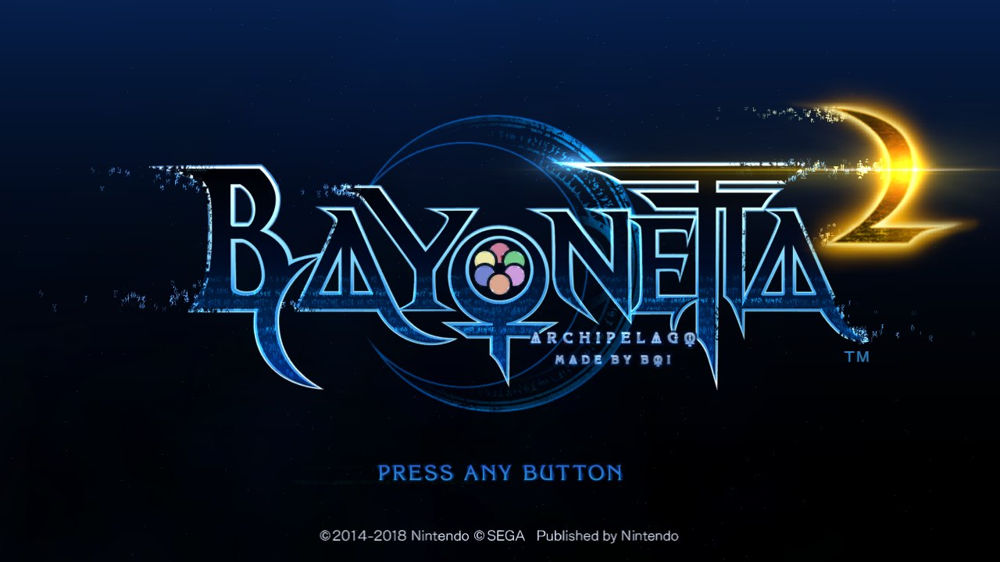

<h1 align="center">Bayonetta 2 Archipelago</h1>

  <b>A multiworld randomizer for Bayonetta 2, played natively on Windows.</b> 
  Checks and items move in real time, the whole client lives inside the game, and two witches can play the story together.

  
  
  
  
  

  <a href="https://github.com/Boi-027/Bayonetta2Archipelago/releases"><b>Download</b></a> ·
  <a href="#installation">Install</a> ·
  <a href="#features">Features</a> ·
  <a href="#screenshots">Screenshots</a> ·
  <a href="#troubleshooting">Troubleshooting</a>

> [!IMPORTANT]
> **No game files are included.** The game is translated and built on your PC from **your own** dump of Bayonetta 2
> (Switch, v1.2) through [B2recomp](B2recomp/README.md). The Archipelago mod's lettering and the launcher's art are made
> from your own game files too. Please don't share anything built from them.

> [!WARNING]
> **This is in testing.** No full playthrough has been done yet. Expect bugs, and back up your saves.

---

## What it is

An [Archipelago](https://archipelago.gg) world for **Bayonetta 2**, running on **B2recomp**, the static recompilation
of the game for Windows. Chapters, verses, chests, crows, books and the Gates of Hell send checks; your weapons,
techniques, accessories and chapter unlocks come from the multiworld.

- **Everything in the game.** Connect from **ARCHIPELAGO** on the title menu. Items and messages show in a chat box.
  No client window, no overlay app.
- **One-click install.** The launcher builds the game, the Archipelago mod and the APWorld, and can take it all away again.
- **Story Co-op.** Play the story with a friend over a direct connection, with shared enemies and verses.
- **Made to match the Bayonetta 1 world.** Same options, goals, traps and links as
  [Bayonetta 1 Archipelago](https://github.com/Boi-027/BayonettaArchipelago).

---

## Screenshots

<table>
  <tr>
    <td width="50%">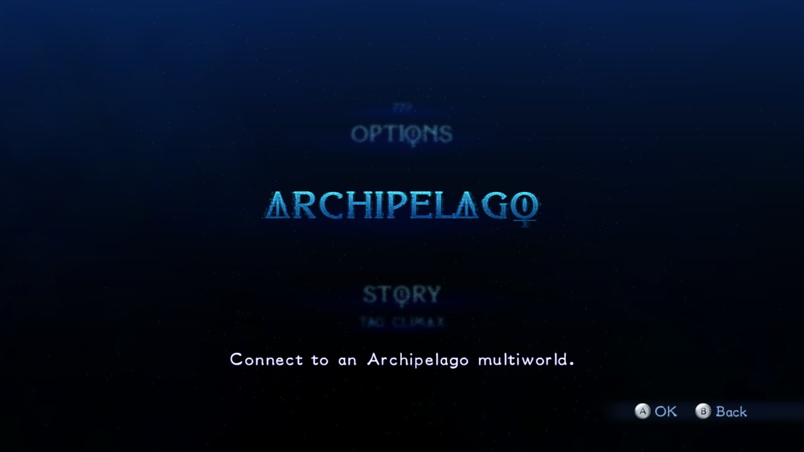 <b>ARCHIPELAGO</b> on the title menu, in the game's own font</td>
    <td width="50%">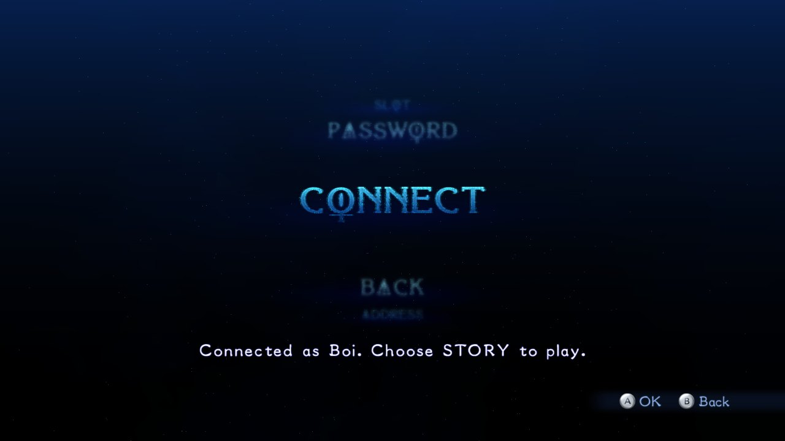 Address, slot and password, then <b>CONNECT</b></td>
  </tr>
  <tr>
    <td>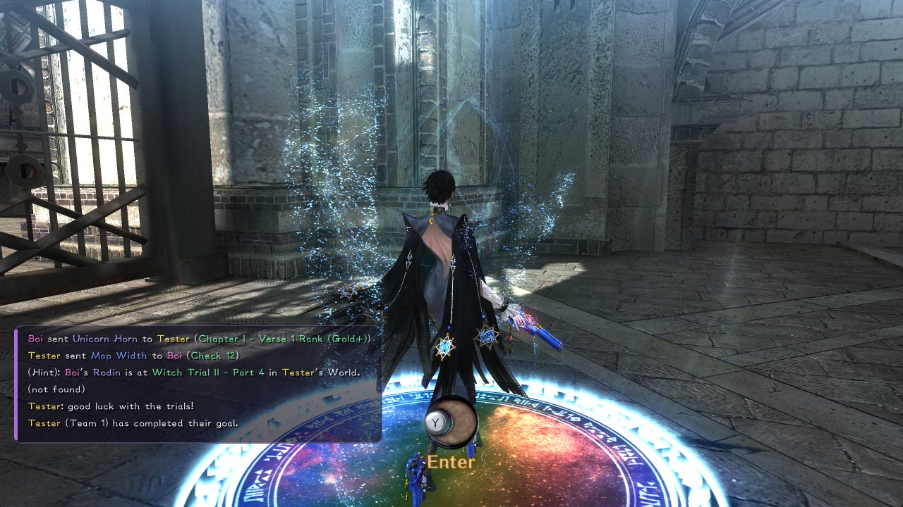 Items, checks, hints and chat in the chat box</td>
    <td>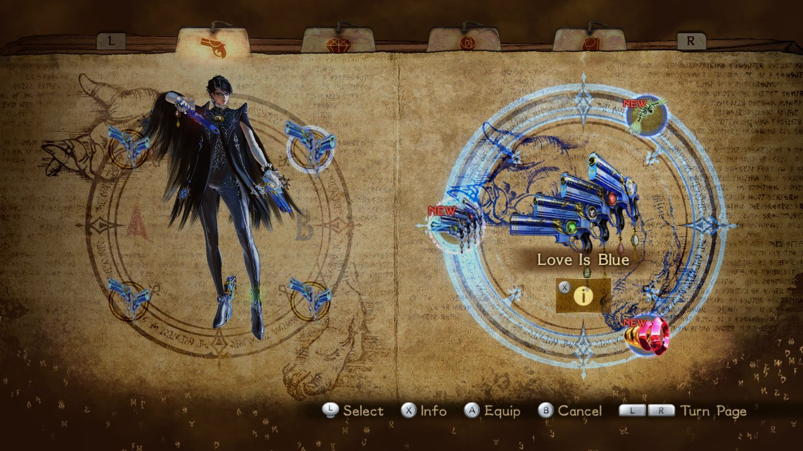 Weapons arrive from the multiworld</td>
  </tr>
  <tr>
    <td>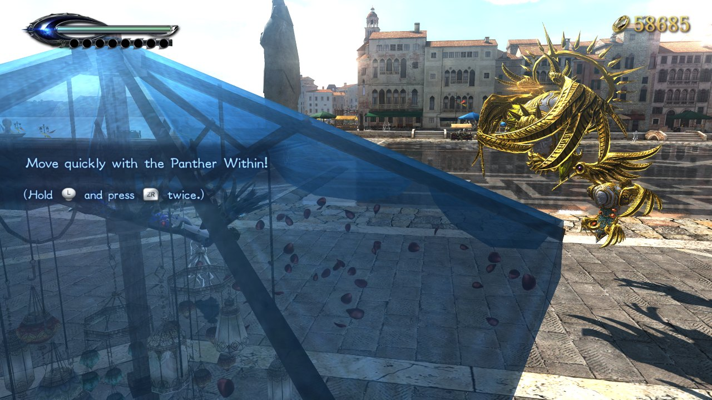 Traps bite back: Gracious &amp; Glorious join the fight</td>
    <td>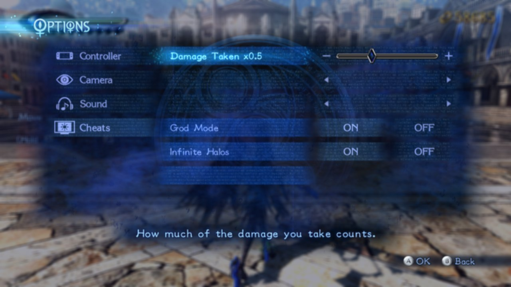 Cheats pages in the game's own Options menu</td>
  </tr>
  <tr>
    <td>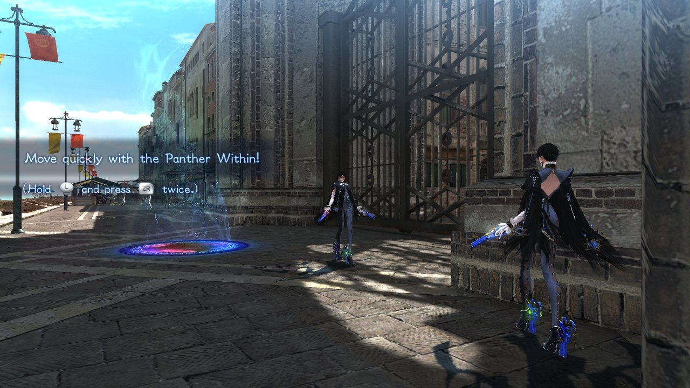 <b>Story Co-op:</b> your partner's Bayonetta in your game</td>
    <td>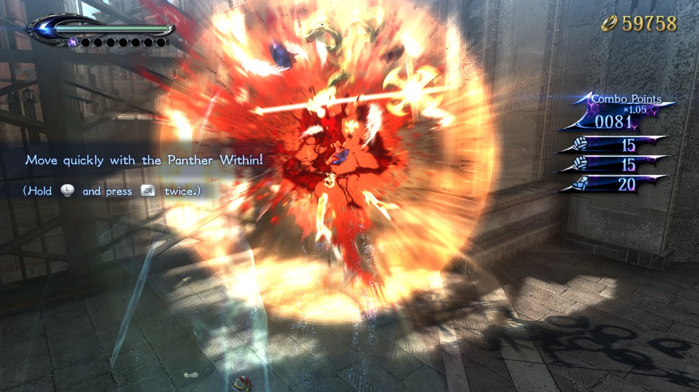 Enemies are shared: hits and kills count in both games</td>
  </tr>
</table>

---

## Features

### The launcher

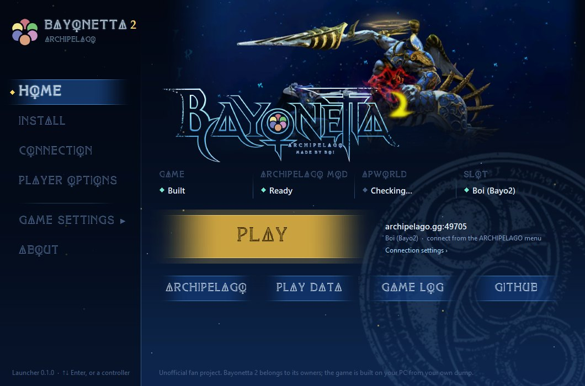

- **One-click install:** choose your dump and press **Install**. It builds the game, builds the Archipelago mod from your
  game files, puts `bayonetta2.apworld` into Archipelago's `custom_worlds` folder and makes a desktop shortcut. It finds
  your Archipelago folder by itself.
- **Update and uninstall:** **Update** rebuilds what changed and refreshes the APWorld (Home tells you when it's out of
  date). **Uninstall** moves everything to the Recycle Bin and keeps your saves and settings.
- **Connection:** server, slot and password, and *connect automatically* so the game connects at the title screen.
- **In-game options:** God Mode, Infinite Halos and Magic, Auto QTEs, Easy Cutscene Skip, Damage Taken, Halo Gain.
- **Player Options:** every option of the world. **Export** writes your YAML straight into Archipelago's Players folder.
- **Looks like the game:** its menu font, title logo and key art (from your own files, at install), the turning Umbran
  seal, and keyboard and controller navigation.

<table>
  <tr>
    <td width="33%">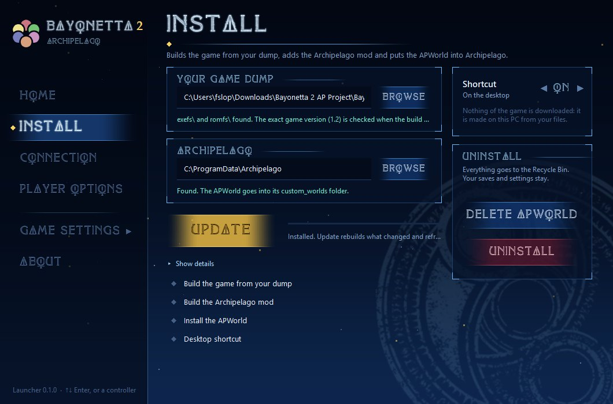 Install, update, uninstall</td>
    <td width="33%">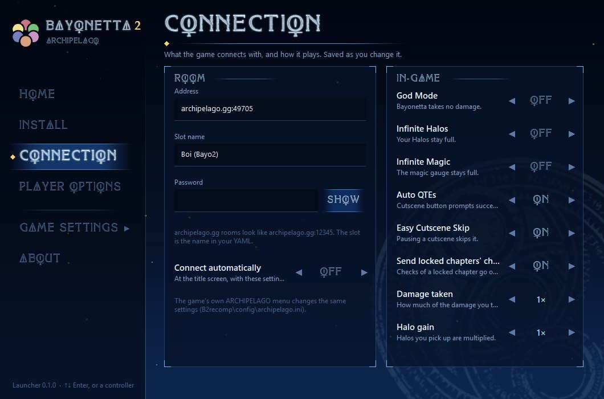 Connection and in-game options</td>
    <td width="33%">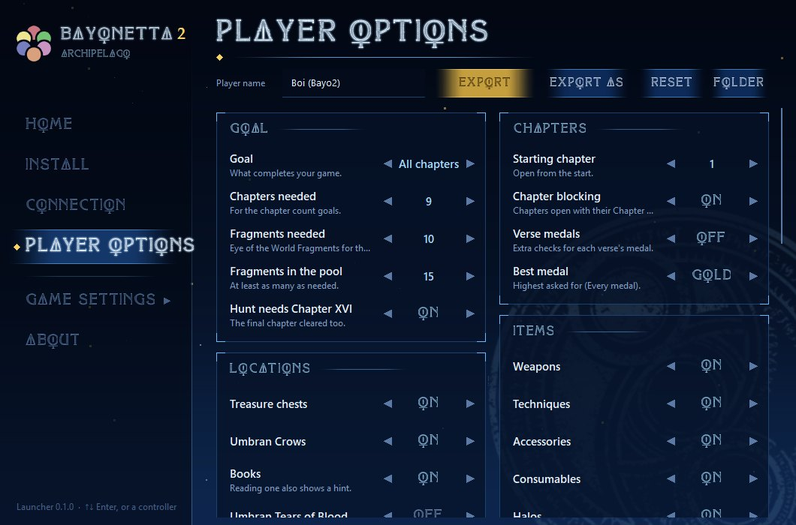 Player Options: your YAML</td>
  </tr>
</table>

### In the game
- **ARCHIPELAGO on the title menu:** address, slot and password on the game's own menu wheel, with on-screen editing.
- **Chat box:** items, checks, hints and chat, coloured like the Archipelago website.
- **Title screen:** the BAYONETTA logo with the Archipelago logo in its O.
- **Cheats (Options → Display, L/R):** God Mode, Infinite Halos, Infinite Magic, Damage Taken and Halo Gain multipliers,
  Auto QTEs, Easy Cutscene Skip.
- **Chapter blocking:** Chapter Select shows only the chapters you've been given (the Prologue, your starting chapter and
  every Chapter Unlock), so you can jump straight to any of them.
- **Book hints:** reading a book in a chapter shows an Archipelago hint.

### Locations and items

| Checks | Items |
|---|---|
| Story chapters (Prologue + I–XVI) | Weapons |
| Every verse, Muspelheims included | Techniques and accessories |
| Treasure chests | Consumables and recipe ingredients |
| All 20 Umbran Crows | Halos |
| The 25 books (each also gives a hint) | Witch Heart and Moon Pearl pieces |
| Gates of Hell: weapons, techniques, accessories | Chapter Unlocks |
| *Optional:* verse medals (with a **maximum medal**), Umbran Tears of Blood, Rodin's Treasures, Tag Climax and the Witch Trials | *Optional:* Eye of the World Fragments |

### Goals
| Goal | What finishes it |
|---|---|
| **All Chapters** | The Prologue and Chapters I–XVI |
| **Chapter Count** | A set number of chapters (the final chapter can be one of them) |
| **Boss Rush** | Only the boss chapters, plus the final chapter |
| **Chapter Count (no final)** | A set number of chapters, the final chapter not needed |
| **Eyes of the World Hunt** | Enough Eye of the World Fragments from the item pool |

### Links
- **Death Link:** when they die, you die. When you die, they die.
- **Damage Link:** part of the damage you take goes to the others. Never lethal on its own.
- **Trap Link:** your traps fire on others, theirs fire on you.
- **Ring Link:** Halos you collect become rings for the others (1 ring = 50 Halos). Shop purchases don't count.

<b>Traps (14)</b>: junk checks can bite back

| Trap | Effect |
|---|---|
| **Pickpocket** | Steals up to 10,000 Halos |
| **Bloodletting** | Halves your HP |
| **Fragile Witch** | Sets you to 1 HP. Don't get hit |
| **Magic Drain** | Empties your magic gauge |
| **Amnesia** | Only your starting techniques work for 60 seconds |
| **Sticky Fingers** | Swipes up to 3 of one item |
| **Squish** | No jumping or dodging for 20 seconds |
| **Squash** | No punching or kicking for 15 seconds |
| **Alfheim Curse** | Three hits within 30 seconds leave you at 1 HP |
| **Berserk** | Every hit counts double for 30 seconds |
| **Angel Ambush** | Three Affinities spawn beside you |
| **Grace & Glory** | The pair joins your fight |
| **Gracious & Glorious** | The upgraded pair joins the fight |
| **Fairness & Fearless** | Another pair of enemies appears beside you |

`trap_percentage` sets how much of the filler becomes traps; `trap_weights` sets how often each one appears.

### Story Co-op *(experimental)*

<table>
  <tr>
    <td width="50%">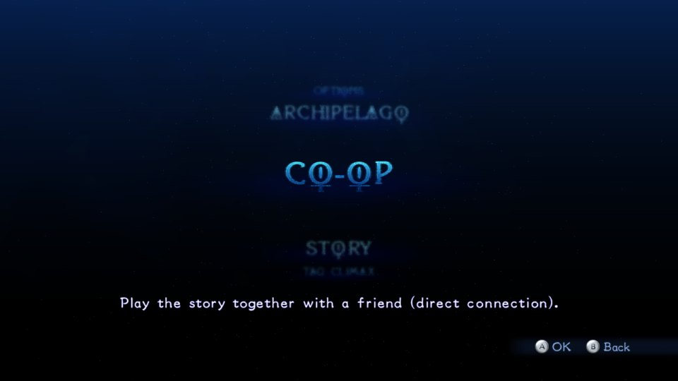 <b>CO-OP</b> on the title menu: host or connect</td>
    <td width="50%">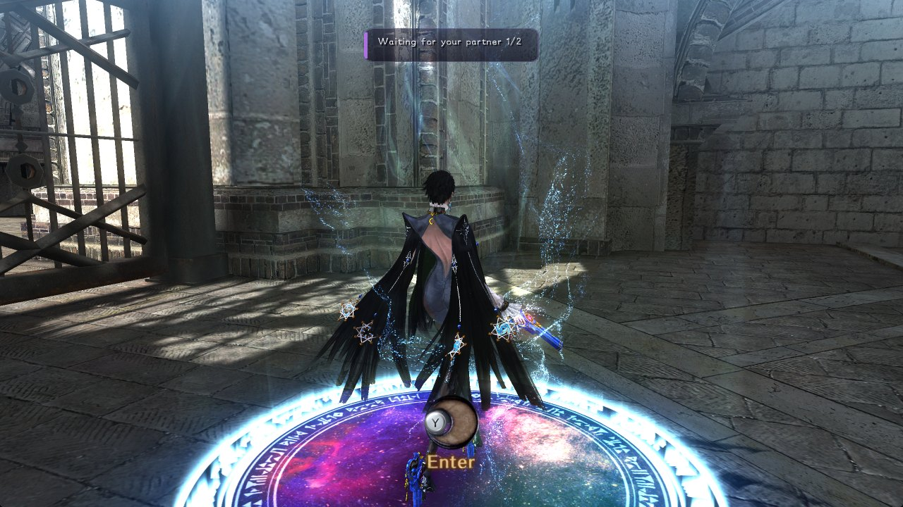 A verse waits until both of you are there</td>
  </tr>
</table>

- **Direct IP:** one player hosts, the other connects to their address (UDP port 27870). Public or private lobbies,
  with an optional password.
- **Your partner in your game:** their Bayonetta, driven by their real inputs.
- **Shared enemies:** waves and the enemies themselves are paired between both games.
- **Verse sync and skip voting:** a verse starts when both of you reach it; a cinematic is skipped when both choose Skip.
- **Falling together:** if one of you dies, both go back to the checkpoint. If a player leaves, their Bayonetta goes too.

---

## Requirements

- **Your own dump of Bayonetta 2 (Switch), version 1.2**, as plain files (`exefs` and `romfs`). See
  [B2recomp/BUILDING.md](B2recomp/BUILDING.md).
- **Windows 10 or 11 (x64)** and a GPU with a **Vulkan 1.3** driver.
- About **2 GB** free for the build.
- An **Archipelago** install (0.6.x) to generate, and a server to play on.

The release brings its own compiler and Python, so there is nothing else to install.

---

## Installation

1. Download **`Bayonetta2Archipelago-<version>.zip`** from the
   [Releases](https://github.com/Boi-027/Bayonetta2Archipelago/releases) page and unzip it to a folder of its own.
2. Start **`Bayonetta 2 Archipelago.exe`** and open **Install**.
3. Choose your dump folder (the one that holds `exefs` and `romfs`), and check that it found your Archipelago folder.
4. Press **Install**. The first build takes **5 to 15 minutes**, most of it compiling.
5. **Back up your saves before playing!** (*Play Data* on the Home page.)

To update, unzip the new release over the old folder and press **Update**.

<b>From the source instead</b>

1. Build B2recomp from your dump ([B2recomp/BUILDING.md](B2recomp/BUILDING.md)); `scripts/ap_patch.py` runs as part of it.
2. `python ap/tools/build_mod.py B2recomp B2recomp/mods/Archipelago` builds the Archipelago mod from your game files.
3. `python ap/tools/pack_apworld.py <Archipelago>/custom_worlds` installs the APWorld.
4. `python ap/tools/build_launcher.py` builds the launcher; `python ap/tools/make_release.py` builds a release.

## APWorld setup

1. The launcher installs `bayonetta2.apworld` for you. If you only generate or host, take it from the
   [Releases](https://github.com/Boi-027/Bayonetta2Archipelago/releases) page and put it in Archipelago's `custom_worlds`
   folder.
2. Make your YAML on the launcher's **Player Options** page and press **Export** (or use *Generate Template Options* in
   the Archipelago Launcher).
3. Generate your multiworld as usual.

> [!NOTE]
> **After updating, regenerate your seed.** Location IDs can change between versions.

## Playing

1. Press **Play** in the launcher.
2. Unless *connect automatically* is on, select **ARCHIPELAGO** on the title menu, set **ADDRESS**, **SLOT** and
   **PASSWORD**, then select **CONNECT**.
3. Select **STORY** and play. Checks go out as you clear verses and chapters, open chests, find crows and books, and buy
   at the Gates of Hell. Items and messages appear in the chat box.

<b>Co-op setup</b>

1. Both players select **CO-OP** on the title menu.
2. Player 1 selects **HOST**. Set a **PASSWORD** first if you want one.
3. Player 2 enters Player 1's IP address in **ADDRESS** and selects **CONNECT**. On the same network, leaving ADDRESS
   empty joins the first public lobby found.
4. Both players start the same chapter. Once you're both in the stage, you'll see each other.

Over the internet, the host needs to forward **UDP port 27870** on their router.
Co-op has only been tested with two copies on one PC so far.

---

## Roadmap

<b>Done</b>

- The Archipelago client inside the game (connect, items, checks, chat, hints)
- ARCHIPELAGO title menu, connect menu and title logo
- Chapter, verse, chest, crow, book, Tears of Blood, Rodin's Treasure and Tag Climax locations
- Verse medal locations with a maximum medal
- Weapons, techniques, accessories, consumables and Halos as items
- Chapter Unlocks, with Chapter Select showing only given chapters
- All five goals, including the Eyes of the World hunt
- Death Link, Damage Link, Trap Link, Ring Link
- 14 traps, four of them spawning enemies
- Chat box and in-game Cheats pages
- Story Co-op: lobby, partner, enemy sync, verse sync, skip voting, falling together
- The launcher: install, update, uninstall, connection, in-game options, YAML editor

**In progress:** a full playthrough · Auto QTEs on a real prompt · co-op on two separate PCs

**To do:** the partner's chosen outfit in co-op · co-op players at different checkpoints

**Not planned:** internet co-op without port forwarding (it would need a relay server)

---

## Troubleshooting

- **Install says the dump folder isn't right:** choose the folder that holds both `exefs` and `romfs`, not one of them.
  The game must be version 1.2.
- **The ARCHIPELAGO menu entries are blank:** the Archipelago mod is missing. Press **Update** in the launcher.
- **Can't connect to a co-op host over the internet:** the host must forward UDP port 27870 (or the port after `:` in
  ADDRESS) to their PC.
- **Locations don't match after an update:** your seed was made with another `.apworld` version. Regenerate it.
- **The game itself misbehaves:** see [B2recomp/README.md](B2recomp/README.md). *Game Log* on the launcher's Home page
  opens the log to attach to a report.
- **Something else, or an idea?** [Open an issue](https://github.com/Boi-027/Bayonetta2Archipelago/issues).

---

## Credits

- Built on [B2recomp](B2recomp/README.md) by K0NL, itself built on [ssbu-recomp](https://github.com/Denkishi/ssbu-recomp)
  by Denkishi.
- Options and features follow my [Bayonetta 1 Archipelago](https://github.com/Boi-027/BayonettaArchipelago) world.
- Project direction and in-game testing by **Boi**.
- [Archipelago](https://github.com/ArchipelagoMW/Archipelago).

## License

- **`B2recomp/`** keeps its own licenses: GPL-3.0-or-later ([B2recomp/LICENSE](B2recomp/LICENSE),
  [B2recomp/NOTICE.md](B2recomp/NOTICE.md)). That includes the Archipelago and co-op code in `B2recomp/runtime/`.
- **The rest** (`ap/`) is under the MIT license in [LICENSE](LICENSE).

Bayonetta 2 is a trademark of its owners. This is an unofficial fan project, not affiliated with Nintendo or
PlatinumGames. Screenshots are from my own copy of the game.

## AI Usage Disclosure

- This project was made with heavy use of AI.
- Most of the code (the Archipelago client, Story Co-op, the game patches, the apworld and the launcher), the reverse
  engineering of the game (`ap/NOTES.md`) and this documentation were written by Claude (Anthropic) through Claude Code.
- I directed the work: I chose the features, made the design decisions, and tested the results in the game.
- B2recomp describes its own AI use in [its README](B2recomp/README.md).
